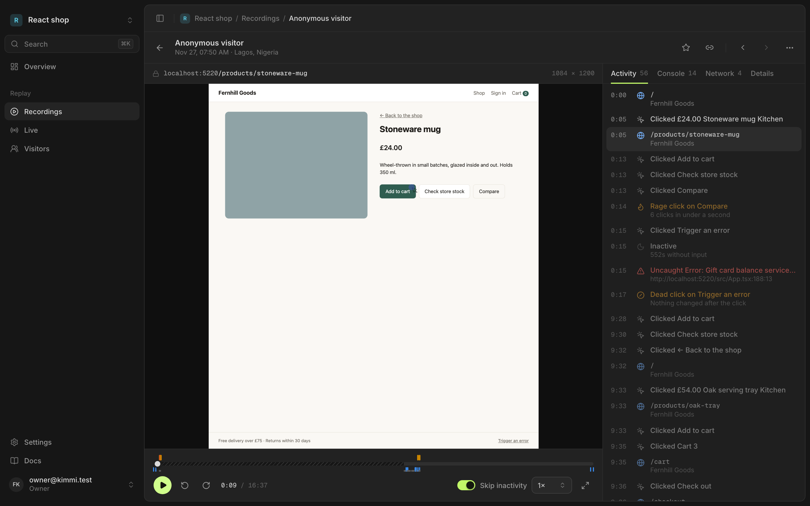

<p align="center">
  <a href="https://github.com/dimmihq/kimmi">
    <picture>
      <source media="(prefers-color-scheme: dark)" srcset=".github/assets/kimmi-logo-dark.svg">
      
    </picture>
  </a>
</p>

<h3 align="center">Open source session replay in one binary</h3>

<p align="center">
  See what your visitors saw: recordings, live sessions, rage clicks, errors, console and network,<br>
  with masking done in the browser. MIT licensed, on your own server, with SQLite or PostgreSQL.
</p>

<p align="center">
  <a href="https://github.com/dimmihq/kimmi/actions/workflows/main.yml"></a>
  <a href="https://github.com/dimmihq/kimmi/releases/latest"></a>
  <a href="https://github.com/dimmihq/kimmi/pkgs/container/kimmi"></a>
  <a href="https://github.com/dimmihq/kimmi/commits/main"></a>
</p>

<p align="center">
  <a href="#get-started">Get started</a> ·
  <a href="#record-a-site">Record a site</a> ·
  <a href="#privacy">Privacy</a> ·
  <a href="#configuration">Configuration</a> ·
  <a href="docs/contract.md">API and protocol</a> ·
  <a href="https://github.com/dimmihq/kimmi/issues/new">Report a bug</a>
</p>

<br>

<p align="center">
  
</p>

## Why kimmi

Session replay tools charge $2 to $8 per thousand sessions and need Kafka, ClickHouse and a row of services to self-host. A recording is a few hundred kilobytes of compressed JSON. kimmi stores it for what the disk costs.

- **One binary:** server, worker and dashboard in a single Go executable. No Kafka, no ClickHouse, no Redis.
- **Cheap to run:** recordings are compressed in the browser, stored untouched, and sealed with zstd when a session ends.
- **Starts small, scales out:** SQLite and a folder on one machine, or PostgreSQL and S3 with separate ingest, API and worker nodes.
- **Private by default:** inputs are masked in the browser, secrets are scrubbed from console and network data, and nothing leaves your server.
- **Fully open source (MIT):** no enterprise edition, no features held back.

## What you get

- **Recordings:** every session with its pages, duration, device and place, filtered by rage clicks, errors, duration or visitor.
- **Player:** real DOM playback built on [rrweb](https://github.com/rrweb-io/rrweb), with inactivity skipped, a timeline of clicks, navigations and errors, and a link to any moment.
- **Live:** watch a session while it happens. The player follows new events every two seconds.
- **Inspector:** activity, console and network beside the recording, each row jumping to its moment.
- **Friction signals:** rage clicks, dead clicks and uncaught errors detected in the browser and counted per session.
- **Visitors:** identify people with one call and see everything they recorded.
- **Projects and team:** unlimited projects, roles, invitations and API tokens.
- **Privacy controls per project:** mask text, mask inputs, block media, mask or block by selector, sampling, URL rules, consent, retention.

## Get started

### Docker Compose

Runs kimmi with PostgreSQL and SeaweedFS (S3-compatible storage):

```bash
git clone https://github.com/dimmihq/kimmi && cd kimmi
cp .env.example .env        # set KIMMI_SECRET to `openssl rand -hex 32`
docker compose up --build
```

Open <http://localhost:8700>, create the first account, create a project and paste the snippet it shows into your site.

### One container

SQLite and local disk, nothing else to run:

```bash
docker run -p 8700:8700 -v kimmi:/data \
  -e KIMMI_SECRET=$(openssl rand -hex 32) \
  ghcr.io/dimmihq/kimmi
```

### The binary

Download `kimmi` for your system from the [latest release](https://github.com/dimmihq/kimmi/releases/latest):

```bash
KIMMI_SECRET=$(openssl rand -hex 32) ./kimmi serve
```

## Record a site

Your kimmi server hosts the recorder. Add one tag:

```html
<script src="https://kimmi.example.com/kimmi.js" data-key="km_pub_..." defer></script>
```

Then, optionally, say who the visitor is:

```js
kimmi.identify('user-42', { email: 'ada@example.com', name: 'Ada' });
```

The same recorder is a typed package, `@kimmi/browser`, in [`sdk/browser`](sdk/browser). Working examples for a React single-page app and Next.js live in [`examples`](examples).

## Privacy

Masking and scrubbing happen in the visitor's browser, before anything is sent. Masked data never reaches your server and cannot be recovered.

- **Inputs** are masked by default; password fields always.
- **Text** can be masked everywhere, or per element with a selector, `data-private` or the `kimmi-mask` class.
- **Elements** can be left out entirely with a selector or the `kimmi-block` class.
- **Console, network and errors** are scrubbed of tokens, passwords, card numbers and, by default, email addresses and phone numbers. Request bodies are off unless you turn them on.
- **Consent, Do Not Track, sampling and retention** are settings of each project.

## Configuration

Everything is an environment variable.

| Variable | Default | |
| --- | --- | --- |
| `KIMMI_SECRET` | required | Signs login cookies, 32 or more characters |
| `KIMMI_PUBLIC_URL` | `http://localhost:8700` | Used in snippets and invite links |
| `KIMMI_DATABASE_URL` | `sqlite://./data/kimmi.db` | `sqlite://path` or `postgres://...` |
| `KIMMI_STORAGE` | `local` | `local` or `s3` |
| `KIMMI_STORAGE_PATH` | `./data/recordings` | Folder for `local` |
| `KIMMI_S3_ENDPOINT`, `_BUCKET`, `_REGION`, `_ACCESS_KEY`, `_SECRET_KEY` | | For `s3` |
| `KIMMI_ROLES` | `all` | `ingest`, `api`, `worker`: run them on separate nodes to scale |
| `KIMMI_SIGNUPS` | `open` | `closed` makes it invitation only |

The full list, the data model, the ingest protocol and the API are in [`docs/contract.md`](docs/contract.md).

## Develop

```bash
make deps      # PostgreSQL and SeaweedFS in Docker
make dev       # server on :8700 against them
make dev-web   # dashboard with hot reload on :5210
make test
make loadtest KEY=km_pub_... SESSIONS=20000 CONCURRENCY=300
```

## Contributing

Issues and pull requests are welcome. Found a bug? [Open an issue](https://github.com/dimmihq/kimmi/issues/new).

kimmi is built by the team behind [dimmi](https://github.com/dimmihq/dimmi), the open customer support platform, which records its own dashboard with it.

## License

[MIT](LICENSE)
